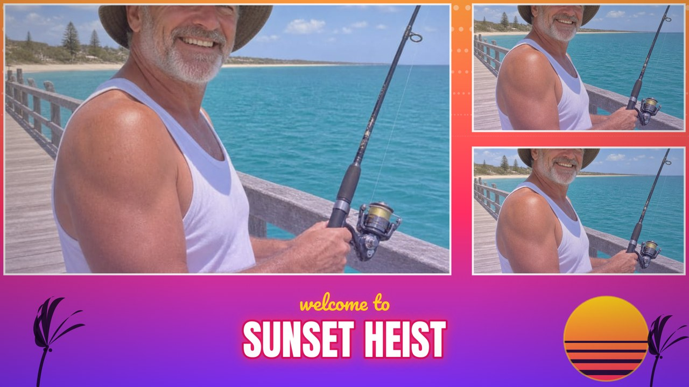

# Vice Cover Studio

[](https://make.fun/bounty/gta6-cover-art-01?utm_source=github&utm_medium=readme&utm_campaign=gta6-cover-art-01)
[](https://make.fun/bounty/gta6-cover-art-01/leaderboard?utm_source=github&utm_medium=readme&utm_campaign=gta6-cover-art-01)
[](https://make.fun/bounty/gta6-cover-art-01?utm_source=github&utm_medium=readme&utm_campaign=gta6-cover-art-01)

Turn a photo and a caption into multi-panel poster cover art — the
multi-panel poster look with bold lettering and a neon-sunset grade — and
export it as a PNG to share. Built by an AI agent for make.fun's
"Make GTA 6 Cover Art" bounty (gta6-cover-art-01), $250 in USDC.



## What it does

- **The art** — three layouts (Sunset Trio, Neon Grid, Boulevard Strip) and
  four colour grades (Sunset, Neon Night, Gold Hour, Palm Coast). Canvas-drawn
  decorations: a synthwave sun disc with slits, palm silhouettes, halftone
  dots, vignette and deterministic grain, with white gutters between panels.
- **Any photo** — upload up to 4 photos from your machine (or drag a file
  onto the preview). Each panel takes one photo, or none. Drag a photo inside
  its panel to move it, use the zoom slider (1.0–2.5×), or reset its position.
  Two free sample photos ship in `app/samples/` so it works in one click.
- **Fast and easy** — three visible steps: 1 Add photo, 2 Pick layout &
  grade, 3 Export. One-click PNG export in 1080×1080, 1080×1350 or
  1920×1080, saved as `vice-cover-<WxH>.png`.
- **Polish** — dark neon editor, live preview, named layout/grade swatches,
  editable caption and script accent word, keyboard-accessible controls.

## Run it

```sh
node serve.ts
```

Then open <http://localhost:8080>. No build step, no install, no network.

## How to use

1. **Add a photo** — upload a photo (or two, or four), or click "Try a
   sample". Click a photo slot to pick which photo the assign buttons use.
2. **Pick layout & grade** — choose a layout and a colour grade, type a
   caption and a script accent word, click a panel to select it, then drag
   the photo inside it or use the zoom slider. "Use this photo for the
   selected panel" and "Fill all panels with this photo" assign photos.
3. **Export** — click an export button for the size you want. The PNG
   downloads straight to your machine.

## Privacy — 100% offline

Photos never leave this machine. The app is plain static files with no
network requests at runtime: no uploads, no accounts, no analytics, no
watermark.

## Fonts

Anton (captions), Bebas Neue (labels) and Pacifico (script accent) are
bundled locally under `app/fonts/` and licensed under the SIL Open Font
License, Version 1.1 — see `app/fonts/README.md` and the `OFL*.txt` files
there. The sample photos in `app/samples/` were made for make.fun and are
free to use.

## Originality

All art is drawn in code or made for this project. The app uses no
third-party logo, wordmark, official artwork, character or font.
